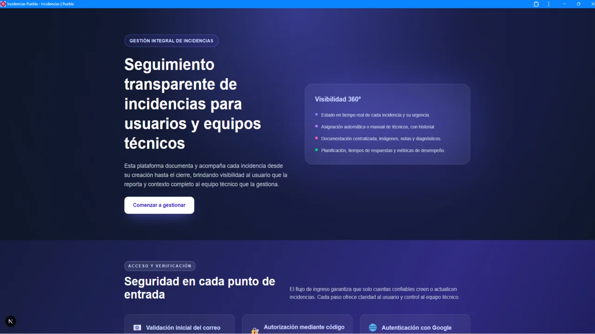
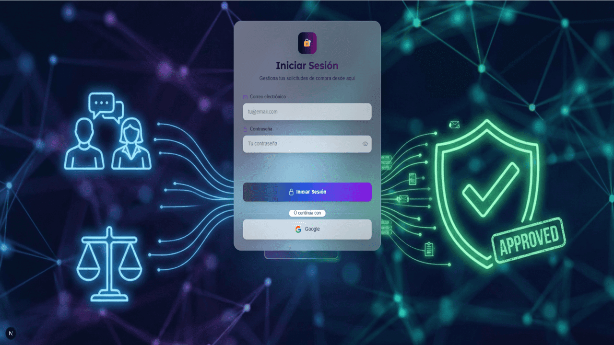
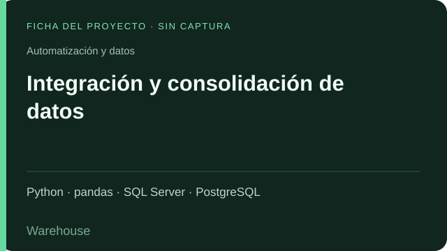
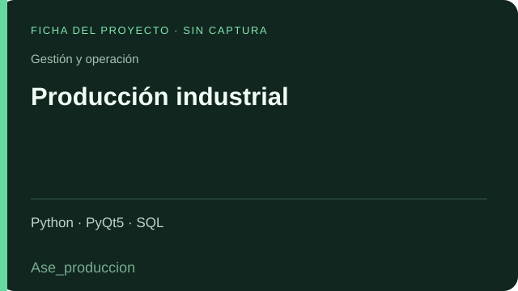
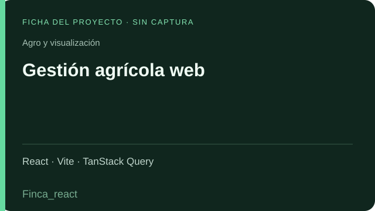
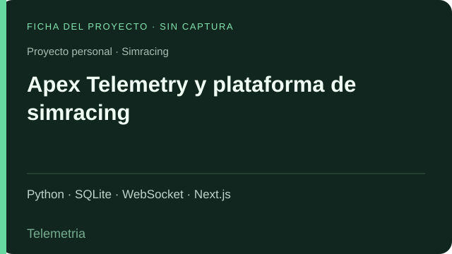

# Daniel Torres

### Gerente Transversal de TI · Desarrollador Full Stack

**Transformo necesidades operativas en aplicaciones, automatizaciones e información para decidir.**

## Sobre mí

Soy Gerente Transversal de TI y desarrollador Full Stack. Acompaño a distintas unidades de negocio en la mejora de sus procesos mediante desarrollo de software, automatización, integración de sistemas y análisis de datos.

**Desde 2017 estudio programación y tecnología de manera autodidacta.** Mi formación se construye con estudio continuo, cursos y práctica, llevando lo aprendido a proyectos y problemas reales del negocio.

Mi trayectoria combina **gestión administrativa, conocimiento de la operación y desarrollo tecnológico**. Esa experiencia me permite entender qué necesita el negocio, traducirlo en una solución y acompañar todo su ciclo: relevamiento, diseño, implementación, despliegue y mantenimiento.

Trabajo con aplicaciones web y de escritorio, bases de datos, flujos automatizados e informes en **Power BI**, con foco en reducir tareas manuales, ordenar la información y dar trazabilidad a la gestión.

## Trayectoria

| Desde | Experiencia |
| :--- | :--- |
| **2017** | Inicio de mi formación autodidacta en programación y tecnología, que mantengo de forma continua. |
| **2018** | Gestión administrativa y contacto directo con la operación. |
| **2023** | Desarrollo de aplicaciones y soluciones de datos para necesidades del negocio. |
| **2025** | Gerencia Transversal de TI: planificación, procesos, sistemas y coordinación entre unidades. |

## Formación autodidacta y referentes

Aprender de forma continua es parte de mi manera de trabajar. Desde 2017 complemento el estudio con proyectos, experimentación y aplicación práctica. Mis principales referentes de formación son:

- **Miguel Ángel Durán - [midudev](https://midu.dev/)** — contenido y formación que acompañan mi aprendizaje en desarrollo web. [Perfil en X](https://x.com/midudev).
- **[Fernando Herrera](https://www.udemy.com/user/550c38655ec11/)** — cursos que forman parte de mi recorrido de aprendizaje en desarrollo de software. [Perfil en X](https://x.com/Fernando_Her85).

Los proyectos de práctica incluidos en este perfil reflejan ese proceso de aprendizaje. Cuando parto de un curso o adapto un proyecto de terceros, lo identifico como tal.

## Qué hago

| Especialidad | Aplicación práctica |
| :--- | :--- |
| **Desarrollo de software** | Aplicaciones web, herramientas de escritorio, APIs y sistemas internos. |
| **Automatización** | Integraciones con n8n, scripts Python, extracción de datos y generación de reportes. |
| **Datos e inteligencia de negocios** | SQL, modelado, transformaciones, DAX, Power Query e informes en Power BI. |
| **Mejora de procesos** | Relevamiento, estandarización, trazabilidad y reducción de tareas repetitivas. |
| **IA aplicada** | Diseño de instrucciones, exploración de asistentes y capacitación para su uso en el trabajo. |

## Tecnologías

### Lenguajes y datos

### Aplicaciones e integraciones

### Automatización, análisis y despliegue

**Experiencia adicional y formación:** Java y Spring Boot, Dart y Flutter, Electron, HTML, CSS y MySQL.

## Trabajo privado, experiencia visible

Gran parte de mi trabajo se desarrolla en **aplicaciones internas y repositorios privados**. Por confidencialidad, el código fuente, las bases de datos y la información operativa de esos proyectos no se comparten públicamente.

Este perfil presenta su propósito y las tecnologías utilizadas. Las imágenes son capturas o recursos de presentación sin datos internos; cuando no hay una captura disponible, se muestra una **ficha identificativa del proyecto**.

El catálogo reúne **54 repositorios privados** con soluciones, integraciones, versiones, bases reutilizables y proyectos de formación. Mis **dos proyectos personales públicos de simracing** se presentan en una sección propia; son desarrollos vinculados a mis intereses fuera del trabajo.

## Proyectos profesionales destacados

<table>
<tr>
<td width="50%" valign="top">

<h3>Gestión integral de incidencias</h3>

Solicitudes, responsables, estados, valoraciones y tiempos de atención.

<code>gestion_incidencia</code> Next.js · React · Prisma · PostgreSQL

Captura del repositorio · Código privado

</td>
<td width="50%" valign="top">

<h3>Aprobación de compras</h3>

Solicitudes, aprobaciones, presupuestos y seguimiento de compras y pagos.

<code>aprobacion_compras_next</code> Next.js · React · Prisma · PostgreSQL

Captura del acceso · Código privado

</td>
</tr>
<tr>
<td width="50%" valign="top">

<h3>Integración y consolidación de datos</h3>

Integración de sistemas y consolidación de datos desde SQL Server hacia PostgreSQL.

<code>Warehouse</code> Python · pandas · SQL Server · PostgreSQL

Ficha identificativa · Código privado

</td>
<td width="50%" valign="top">

<h3>Producción industrial</h3>

Registro de producción, cargas masivas y consultas para la operación industrial.

<code>Ase_produccion</code> Python · PyQt5 · SQL

Ficha identificativa · Código privado

</td>
</tr>
<tr>
<td width="50%" valign="top">

<h3>Gestión financiera</h3>

Cheques, clientes, cobranzas, transacciones, cierres de caja y flujo de fondos.

<code>Py_gestion</code> Python · Qt · SQL · Excel

Ficha identificativa · Código privado

</td>
<td width="50%" valign="top">

<h3>Gestión agrícola web</h3>

Gestión de fincas, cuadros, proyectos y registros de siembra.

<code>Finca_react</code> React · Vite · TanStack Query

Ficha identificativa · Código privado

</td>
</tr>
</table>

**Otras líneas de trabajo:** gestión financiera, vales de combustible, turnos para consultorios, stock de lubricantes, generación de reportes, firma manuscrita sobre documentos y comunicación de indicadores.

## Proyectos personales públicos

Desarrollo estos proyectos por mi interés en el **simracing**. Son iniciativas personales, independientes de mi actividad profesional, y su código está disponible públicamente.

<table>
<tr>
<td width="50%" valign="top">

<h3><a href="https://github.com/Danito90/Telemetria">Apex Telemetry</a></h3>

Captura y análisis de telemetría, sesiones y vueltas de F1 y Assetto Corsa, con visualización en tiempo real y herramientas de comparación.

Python · SQLite · WebSocket · Next.js

<b>Proyecto personal · Código público</b>

</td>
<td width="50%" valign="top">

<h3><a href="https://github.com/Danito90/f1-league-app">F1 League App</a></h3>

Gestión de ligas, temporadas, pilotos, constructores, carreras, resultados y tablas de posiciones.

Next.js · TypeScript · Prisma

<b>Proyecto personal · Código público</b>

</td>
</tr>
</table>

## Catálogo de proyectos privados y personales

[**Ver el catálogo: 54 repositorios privados y 2 proyectos personales públicos →**](docs/PROYECTOS.md)

Los nombres identifican los repositorios de mi cuenta. Los proyectos de práctica, las versiones relacionadas y las adaptaciones de terceros se señalan expresamente.

<b>Gestión y operación</b> · 13 repositorios

| Repositorio | Qué hace | Tipo |
| :--- | :--- | :--- |
| `gestion_incidencia` | **Gestión integral de incidencias.** Registra solicitudes, asigna técnicos y documenta estados, comentarios, valoraciones y tiempos de atención. Incluye indicadores y un catálogo interno de aplicaciones. | Aplicación |
| `aprobacion_compras_next` | **Aprobación de compras.** Centraliza solicitudes, aprobación de ítems y presupuestos, gestión de compra, documentación y seguimiento de pagos. Conserva historial y responsabilidades por etapa. | Aplicación |
| `Ase_produccion` | **Producción industrial.** Aplicación de escritorio para cargar producción, consultar registros y gestionar cargas masivas de armado y ventas, con catálogos de empleados, clientes, marcas y turnos. | Aplicación |
| `Py_gestion` | **Gestión financiera.** Herramienta de escritorio con módulos de cheques, clientes, monedas, tipos de cambio, cobranzas, transacciones, cierres de caja y flujo de fondos. | Aplicación |
| `Romano_group` | **Gestión administrativa y comercial.** Aplicación de escritorio con presupuestos, facturación, caja, cheques, anticipos y órdenes de pago. Integra consultas y procesos de gestión en una misma interfaz. | Aplicación |
| `Pyside_turnos` | **Gestión de turnos para consultorios.** Organiza turnos, pacientes o clientes, profesionales, tratamientos y estados de atención mediante una interfaz de escritorio y persistencia en base de datos. | Aplicación |
| `ValesDjango` | **Gestión de vales de combustible.** Relaciona vales con estaciones, transportes, vehículos y choferes; registra litros, combustible, fechas y vencimientos. | Aplicación |
| `planillaPlaya` | **Planilla operativa de playa.** Herramienta de escritorio para registrar información operativa de playa, trabajar con empleados y consultas de base de datos, y emitir reportes PDF. | Aplicación |
| `StockLubricantes` | **Consulta de stock de lubricantes.** Interfaz de escritorio para consultar y presentar información de lubricantes mediante modelos SQL, tablas y tareas en segundo plano. | Aplicación |
| `Limpieza_saldos` | **Depuración de planillas y saldos.** Carga planillas Excel de zonas, saldos, pagos y compras para cruzar información, aplicar códigos de filtrado y obtener una selección de clientes. | Aplicación |
| `Firma_digital` | **Firma manuscrita sobre documentos.** Permite dibujar una firma, cargar documentos y ajustar su color, tamaño y posición. El código corresponde a una firma gráfica; no acredita firma criptográfica con certificados. | Herramienta |
| `firma_documento` | **Firma gráfica en el navegador.** Herramienta web para capturar una firma manuscrita y ubicarla sobre un documento, con controles de tamaño, color, texto y previsualización de PDF. | Herramienta |
| `PWA_incidencia` | **Gestión de incidencias en formato PWA.** Otra implementación de la familia de incidencias, con creación, asignación, atención, cierre y valoración, preparada como aplicación web instalable. | Versión relacionada |

<b>Medición de combustibles</b> · 5 repositorios

| Repositorio | Qué hace | Tipo |
| :--- | :--- | :--- |
| `Medicion_unico` | **Medición de tanques unificada.** Centraliza la medición de combustible para distintas estaciones: convierte lecturas a litros y contempla medición diaria, agua, ajustes y descargas. | Aplicación |
| `Med_GncDp` | **Medición de tanques — GNC Don Pedro.** Versión específica para una estación, con conversión de mediciones a litros mediante tablas de calibración por combustible. | Versión por estación |
| `Med_junin` | **Medición de tanques — Junín.** Calculadora de volumen de combustible a partir de mediciones y tablas de calibración propias de la estación. | Versión por estación |
| `med_Pamisa` | **Medición de tanques — Pamisa.** Variante de la herramienta de medición con tablas de calibración y entradas por producto para los tanques de esta estación. | Versión por estación |
| `med_san-juan` | **Medición de tanques — San Juan.** Implementación de escritorio para calcular litros de combustible según las mediciones y tablas de calibración de la estación. | Versión por estación |

<b>Automatización y datos</b> · 7 repositorios

| Repositorio | Qué hace | Tipo |
| :--- | :--- | :--- |
| `Warehouse` | **Integración y consolidación de datos.** Proceso ETL que extrae información de SQL Server, aplica cargas y actualizaciones sobre PostgreSQL y admite ejecución programada o con interfaz gráfica. | ETL |
| `Fusion_dll` | **Integración con Fusion mediante DLL.** Extrae información de ventas y turnos mediante una biblioteca DLL, transforma las respuestas y las integra con la base de datos de destino. | Integración |
| `UpFusionUnico` | **Actualización de Fusion configurable.** Unifica descargas e importación de información con configuración de ejecución única, por intervalos o en horarios determinados. | Automatización |
| `Auto_axion` | **Automatización de descargas operativas.** Automatiza el acceso a Fusion, la descarga de archivos y su procesamiento para integrar datos con menos intervención manual. | Automatización |
| `AxionCard` | **Descarga automatizada de transacciones.** Automatiza con Selenium el acceso al portal, la selección de empresa y período y la descarga de movimientos para su posterior procesamiento. | Automatización |
| `Carga_expendio` | **Carga de datos de expendios.** Importa datos de expendios desde Access hacia PostgreSQL, transforma registros y dispone de utilidades para obtener coordenadas geográficas. | ETL |
| `Envio_ventas` | **Generación automática de reportes de ventas.** Consulta mediciones, ventas y proyecciones por empresa y genera archivos en PDF, Excel e imagen. El código revisado confirma la generación; no se presupone envío automático por correo. | Reportes |

<b>Agro y visualización</b> · 8 repositorios

| Repositorio | Qué hace | Tipo |
| :--- | :--- | :--- |
| `Api_finca` | **API de gestión agrícola.** API REST para administrar fincas, cuadros, proyectos, tipos y variedades de ajo, y registros de siembra, con filtros y operaciones de consulta y mantenimiento. | Backend |
| `Finca_react` | **Gestión agrícola web.** Interfaz para consultar y mantener fincas, cuadros, proyectos y siembras. Incluye autenticación, filtros y utilidades de exportación para trabajar con la API agrícola. | Frontend |
| `formularios-frontend` | **Formularios e indicadores operativos.** PWA para administrar empleados, puestos, evaluaciones ERA, cliente incógnito, promociones e imágenes, con vistas y permisos según el perfil. | Frontend |
| `Formularios_carga` | **API de formularios operativos.** Backend con autenticación JWT y operaciones sobre empleados, puestos, evaluaciones ERA, cliente incógnito, promociones e imágenes. | Backend |
| `Formularios_Django` | **Formularios operativos en Django.** Implementación en Django de registros por empresa y período para evaluaciones ERA, cliente incógnito y promociones. | Versión relacionada |
| `landing_playa` | **Panel de indicadores de playa.** Presenta litros, promociones y mezcla de ventas en distintas vistas, con gráficos, autenticación y configuración de la rotación de contenidos. | Aplicación |
| `carrousel_playa` | **Carrusel de indicadores y comunicación.** Muestra un carrusel con indicadores de litros, lubricantes, mezcla de ventas, promociones y cliente incógnito, con configuración y control de conexión. | Versión relacionada |
| `landing-page-server` | **API para paneles de playa.** Servicio de consultas para los paneles y carruseles: autenticación, información de Fusion e imágenes sobre una base PostgreSQL. | Backend |

<b>Web y contenido</b> · 2 repositorios

| Repositorio | Qué hace | Tipo |
| :--- | :--- | :--- |
| `blog_personal_carlos` | **Blog personal con administración.** Blog con gestión de publicaciones, categorías, usuarios y perfil, panel privado, contenidos multimedia y seguimiento analítico. | Aplicación |
| `cv` | **Currículum web administrable.** Aplicación web para organizar datos personales, formación, cursos, experiencia laboral, habilidades e imágenes mediante módulos de gestión. | Proyecto |

<b>Bases, aprendizaje e IA</b> · 15 repositorios

| Repositorio | Qué hace | Tipo |
| :--- | :--- | :--- |
| `base_next_auth` | **Base de autenticación y permisos.** Punto de partida reutilizable con acceso por credenciales y proveedores externos, usuarios, roles, grupos y permisos para aplicaciones Next.js. | Base reutilizable |
| `whisper-local-transcribe-Editado` | **Transcripción local de audio y video.** Adaptación de Local Transcribe with Whisper, de soderstromkr, con interfaz de escritorio, selección de idioma/modelo y procesamiento local con faster-whisper. | Adaptación de terceros |
| `01-socket-server` | **Servidor de comunicación en tiempo real.** Base de servidor Express y Socket.IO para practicar conexiones y eventos entre clientes y servidor. | Práctica |
| `22-calendar-backend` | **API de calendario.** Backend de práctica con registro e inicio de sesión, validación JWT y operaciones de creación, consulta, modificación y eliminación de eventos. | Práctica |
| `asgiDjango` | **Chat por salas con Django Channels.** Prueba de comunicación asíncrona mediante WebSocket: conexión a salas, mensajes y distribución a los participantes del grupo. | Prototipo |
| `04-Wheater_app-Curso-Opencode` | **Weather CLI.** Proyecto de aprendizaje con OpenCode: consulta clima y pronóstico de siete días por ciudad, guarda ubicaciones, configura unidades y temas y puede compilarse como ejecutable. | Proyecto de aprendizaje |
| `06-open-pacman` | **Pac-Man en el navegador.** Juego con laberinto, puntuación, vidas, comportamientos de fantasmas y potenciadores; utilizado para practicar desarrollo guiado por especificaciones. | Proyecto de aprendizaje |
| `BibliotecaApp` | **Catálogo de biblioteca.** Aplicación de aprendizaje de Django con libros, autores, editores, portadas, búsquedas y vistas de mantenimiento. | Proyecto de aprendizaje |
| `DjangoApp` | **Prototipo de presupuesto.** Proyecto inicial de presupuesto con categorías y subcategorías de ingresos y egresos. El módulo de movimientos revisado permanece sin implementar. | Prototipo |
| `first-step` | **Primeros pasos con Next.js.** Práctica de estructura de páginas, layouts, navegación y enlaces activos, con secciones de inicio, contacto, información y precios. | Práctica |
| `Teslo` | **Teslo Shop.** Proyecto de práctica de tienda en línea con catálogo, categorías, carrito, direcciones, pedidos y autenticación sobre Next.js y Prisma. | Proyecto de aprendizaje |
| `Vite_electron` | **Base de escritorio con Electron y React.** Proyecto de exploración de aplicaciones de escritorio con Electron, React y Vite, comunicación IPC y cambios de tema. | Base de aprendizaje |
| `modulo2` | **Fundamentos de Dart.** Colección de ejercicios sobre variables, condicionales, ciclos, funciones, listas, mapas, clases, herencia e interfaces. | Ejercicios |
| `PruebasQT` | **Laboratorio de interfaces Qt.** Colección de pruebas de controles, tablas, calendarios, ventanas, estilos, procesos asíncronos, generación de PDF y acceso a datos. | Laboratorio |
| `git_inicial` | **Práctica inicial de Git y HTML.** Repositorio de iniciación con una página estática, estilos y recursos. Su documentación no define una aplicación de negocio. | Práctica |

<b>Pruebas de repositorio</b> · 4 repositorios

| Repositorio | Qué hace | Tipo |
| :--- | :--- | :--- |
| `Egg` | **Repositorio inicial de formación.** El repositorio figura en la cuenta, pero su consulta de contenido devuelve una lista vacía. No hay una aplicación identificable para describir. | Sin contenido visible |
| `Ejercicio01` | **Ejercicio básico de Git.** Contiene un archivo de texto con un ejercicio de edición y seguimiento de cambios; no corresponde a una aplicación. | Ejercicio |
| `GitImpulsa` | **Prueba de página y cambios en Git.** Repositorio personal con una página HTML de prueba; se incluye por pertenecer a Danito90, sin incorporar repositorios de organizaciones. | Prueba |
| `practica_github` | **Práctica grupal de GitHub.** Repositorio con documentación de práctica grupal; no contiene una aplicación ejecutable identificable. | Ejercicio |

## Cómo trabajo

- **Entiendo la operación:** parto de la necesidad y del proceso que debe mejorar.
- **Defino el alcance:** establezco qué resolver y cómo comprobar el resultado.
- **Integro las soluciones:** aplicaciones, datos y automatizaciones deben funcionar en conjunto.
- **Documento y acompaño:** dejo contexto para operar y mantener cada implementación.
- **Busco mejoras medibles:** menos trabajo manual, información confiable y mayor trazabilidad.

---

**Tecnología con propósito: simplificar la operación, conectar la información y mejorar los procesos.**

[Conectemos en LinkedIn](https://www.linkedin.com/in/daniel-torres-0b2023214/)

