# Proyectos de Daniel Torres

[← Volver al perfil](../README.md)

Catálogo funcional de **54 repositorios privados y 2 proyectos personales públicos pertenecientes a Danito90**, revisado el 21 de octubre de 2026. Los proyectos personales de simracing se presentan en una sección independiente de la actividad profesional. No incluye repositorios de organizaciones.

Una entrada puede ser una aplicación, una versión, un backend, una base reutilizable o un ejercicio. Las descripciones se basan en documentación, estructura y archivos representativos; no implican que se haya ejecutado o validado cada aplicación en producción.

**Imágenes:** tres capturas existentes y 53 fichas identificativas creadas con el nombre y las tecnologías del proyecto. Las fichas no representan pantallas de las aplicaciones. [Ver procedencia de las imágenes](FUENTES_VISUALES.md).

## Gestión y operación

| Proyecto | Repositorio y descripción |
| :--- | :--- |
|  | **Gestión integral de incidencias** <code>gestion_incidencia</code> · Aplicación Registra solicitudes, asigna técnicos y documenta estados, comentarios, valoraciones y tiempos de atención. Incluye indicadores y un catálogo interno de aplicaciones. Next.js · React · Prisma · PostgreSQL · Captura del repositorio |
|  | **Aprobación de compras** <code>aprobacion_compras_next</code> · Aplicación Centraliza solicitudes, aprobación de ítems y presupuestos, gestión de compra, documentación y seguimiento de pagos. Conserva historial y responsabilidades por etapa. Next.js · React · Prisma · PostgreSQL · Captura del acceso |
|  | **Producción industrial** <code>Ase_produccion</code> · Aplicación Aplicación de escritorio para cargar producción, consultar registros y gestionar cargas masivas de armado y ventas, con catálogos de empleados, clientes, marcas y turnos. Python · PyQt5 · SQL · Ficha identificativa |
|  | **Gestión financiera** <code>Py_gestion</code> · Aplicación Herramienta de escritorio con módulos de cheques, clientes, monedas, tipos de cambio, cobranzas, transacciones, cierres de caja y flujo de fondos. Python · Qt · SQL · Excel · Ficha identificativa |
|  | **Gestión administrativa y comercial** <code>Romano_group</code> · Aplicación Aplicación de escritorio con presupuestos, facturación, caja, cheques, anticipos y órdenes de pago. Integra consultas y procesos de gestión en una misma interfaz. Python · PyQt5 · SQL · Ficha identificativa |
|  | **Gestión de turnos para consultorios** <code>Pyside_turnos</code> · Aplicación Organiza turnos, pacientes o clientes, profesionales, tratamientos y estados de atención mediante una interfaz de escritorio y persistencia en base de datos. Python · PySide6 · PostgreSQL · Ficha identificativa |
|  | **Gestión de vales de combustible** <code>ValesDjango</code> · Aplicación Relaciona vales con estaciones, transportes, vehículos y choferes; registra litros, combustible, fechas y vencimientos. Python · Django · Ficha identificativa |
| 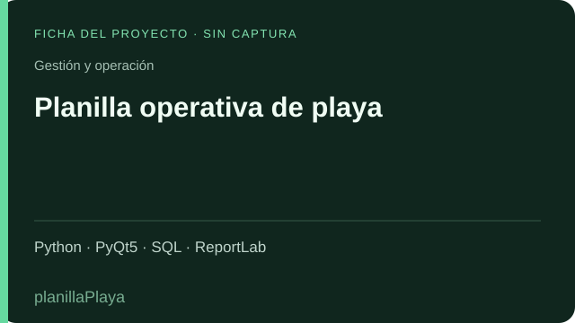 | **Planilla operativa de playa** <code>planillaPlaya</code> · Aplicación Herramienta de escritorio para registrar información operativa de playa, trabajar con empleados y consultas de base de datos, y emitir reportes PDF. Python · PyQt5 · SQL · ReportLab · Ficha identificativa |
| 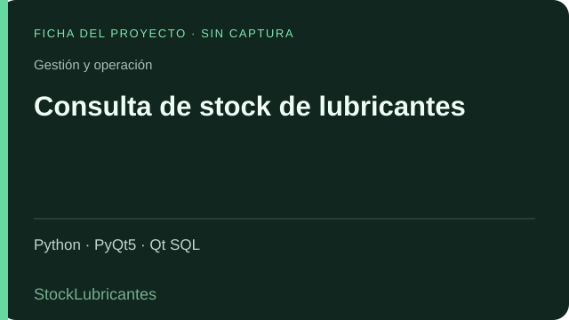 | **Consulta de stock de lubricantes** <code>StockLubricantes</code> · Aplicación Interfaz de escritorio para consultar y presentar información de lubricantes mediante modelos SQL, tablas y tareas en segundo plano. Python · PyQt5 · Qt SQL · Ficha identificativa |
|  | **Depuración de planillas y saldos** <code>Limpieza_saldos</code> · Aplicación Carga planillas Excel de zonas, saldos, pagos y compras para cruzar información, aplicar códigos de filtrado y obtener una selección de clientes. Python · PyQt5 · pandas · Excel · Ficha identificativa |
|  | **Firma manuscrita sobre documentos** <code>Firma_digital</code> · Herramienta Permite dibujar una firma, cargar documentos y ajustar su color, tamaño y posición. El código corresponde a una firma gráfica; no acredita firma criptográfica con certificados. Python · PyQt6 · PyMuPDF · Ficha identificativa |
| 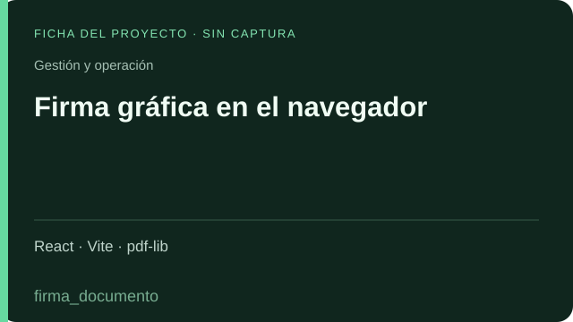 | **Firma gráfica en el navegador** <code>firma_documento</code> · Herramienta Herramienta web para capturar una firma manuscrita y ubicarla sobre un documento, con controles de tamaño, color, texto y previsualización de PDF. React · Vite · pdf-lib · Ficha identificativa |
| 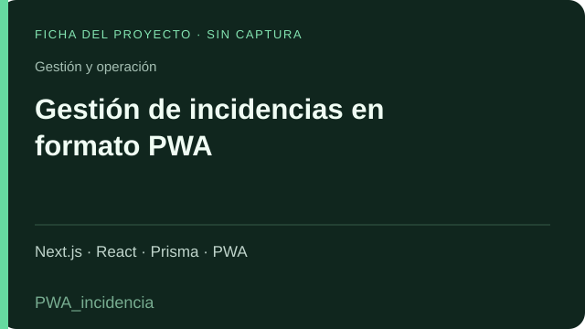 | **Gestión de incidencias en formato PWA** <code>PWA_incidencia</code> · Versión relacionada Otra implementación de la familia de incidencias, con creación, asignación, atención, cierre y valoración, preparada como aplicación web instalable. Next.js · React · Prisma · PWA · Ficha identificativa |

## Medición de combustibles

| Proyecto | Repositorio y descripción |
| :--- | :--- |
| 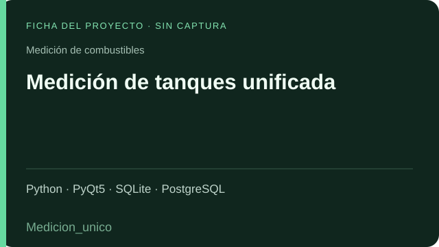 | **Medición de tanques unificada** <code>Medicion_unico</code> · Aplicación Centraliza la medición de combustible para distintas estaciones: convierte lecturas a litros y contempla medición diaria, agua, ajustes y descargas. Python · PyQt5 · SQLite · PostgreSQL · Ficha identificativa |
|  | **Medición de tanques — GNC Don Pedro** <code>Med_GncDp</code> · Versión por estación Versión específica para una estación, con conversión de mediciones a litros mediante tablas de calibración por combustible. Python · PyQt5 · Ficha identificativa |
|  | **Medición de tanques — Junín** <code>Med_junin</code> · Versión por estación Calculadora de volumen de combustible a partir de mediciones y tablas de calibración propias de la estación. Python · PyQt5 · Ficha identificativa |
|  | **Medición de tanques — Pamisa** <code>med_Pamisa</code> · Versión por estación Variante de la herramienta de medición con tablas de calibración y entradas por producto para los tanques de esta estación. Python · PyQt5 · Ficha identificativa |
| 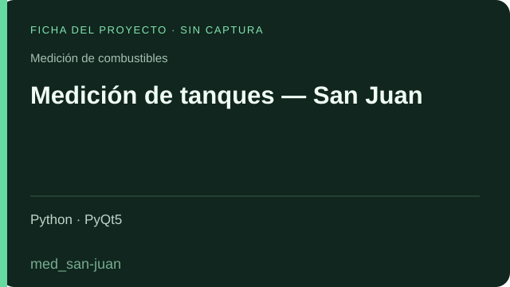 | **Medición de tanques — San Juan** <code>med_san-juan</code> · Versión por estación Implementación de escritorio para calcular litros de combustible según las mediciones y tablas de calibración de la estación. Python · PyQt5 · Ficha identificativa |

## Automatización y datos

| Proyecto | Repositorio y descripción |
| :--- | :--- |
|  | **Integración y consolidación de datos** <code>Warehouse</code> · ETL Proceso ETL que extrae información de SQL Server, aplica cargas y actualizaciones sobre PostgreSQL y admite ejecución programada o con interfaz gráfica. Python · pandas · SQL Server · PostgreSQL · Ficha identificativa |
|  | **Integración con Fusion mediante DLL** <code>Fusion_dll</code> · Integración Extrae información de ventas y turnos mediante una biblioteca DLL, transforma las respuestas y las integra con la base de datos de destino. Python · DLL · SQL · Ficha identificativa |
|  | **Actualización de Fusion configurable** <code>UpFusionUnico</code> · Automatización Unifica descargas e importación de información con configuración de ejecución única, por intervalos o en horarios determinados. Python · schedule · SQL · Ficha identificativa |
|  | **Automatización de descargas operativas** <code>Auto_axion</code> · Automatización Automatiza el acceso a Fusion, la descarga de archivos y su procesamiento para integrar datos con menos intervención manual. Python · PyAutoGUI · SQL · Ficha identificativa |
| 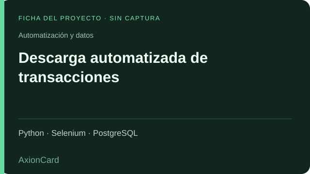 | **Descarga automatizada de transacciones** <code>AxionCard</code> · Automatización Automatiza con Selenium el acceso al portal, la selección de empresa y período y la descarga de movimientos para su posterior procesamiento. Python · Selenium · PostgreSQL · Ficha identificativa |
| 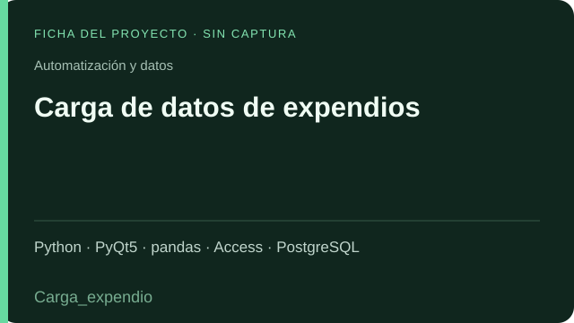 | **Carga de datos de expendios** <code>Carga_expendio</code> · ETL Importa datos de expendios desde Access hacia PostgreSQL, transforma registros y dispone de utilidades para obtener coordenadas geográficas. Python · PyQt5 · pandas · Access · PostgreSQL · Ficha identificativa |
| 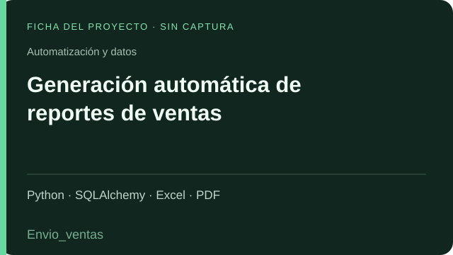 | **Generación automática de reportes de ventas** <code>Envio_ventas</code> · Reportes Consulta mediciones, ventas y proyecciones por empresa y genera archivos en PDF, Excel e imagen. El código revisado confirma la generación; no se presupone envío automático por correo. Python · SQLAlchemy · Excel · PDF · Ficha identificativa |

## Agro y visualización

| Proyecto | Repositorio y descripción |
| :--- | :--- |
| 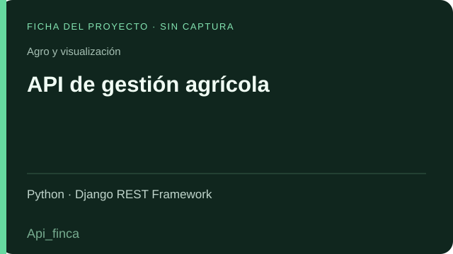 | **API de gestión agrícola** <code>Api_finca</code> · Backend API REST para administrar fincas, cuadros, proyectos, tipos y variedades de ajo, y registros de siembra, con filtros y operaciones de consulta y mantenimiento. Python · Django REST Framework · Ficha identificativa |
|  | **Gestión agrícola web** <code>Finca_react</code> · Frontend Interfaz para consultar y mantener fincas, cuadros, proyectos y siembras. Incluye autenticación, filtros y utilidades de exportación para trabajar con la API agrícola. React · Vite · TanStack Query · Ficha identificativa |
| 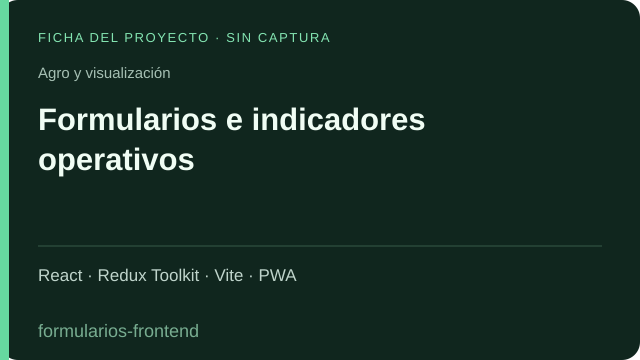 | **Formularios e indicadores operativos** <code>formularios-frontend</code> · Frontend PWA para administrar empleados, puestos, evaluaciones ERA, cliente incógnito, promociones e imágenes, con vistas y permisos según el perfil. React · Redux Toolkit · Vite · PWA · Ficha identificativa |
| 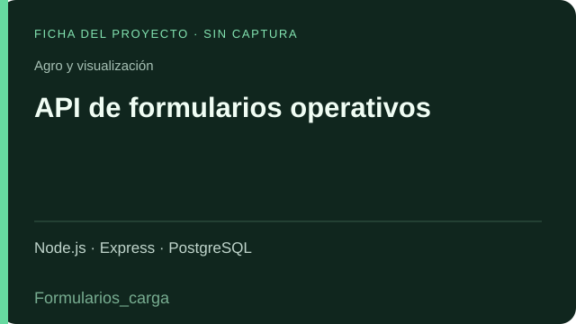 | **API de formularios operativos** <code>Formularios_carga</code> · Backend Backend con autenticación JWT y operaciones sobre empleados, puestos, evaluaciones ERA, cliente incógnito, promociones e imágenes. Node.js · Express · PostgreSQL · Ficha identificativa |
| 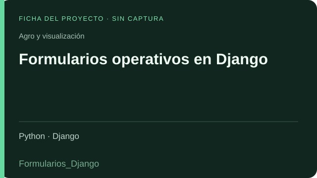 | **Formularios operativos en Django** <code>Formularios_Django</code> · Versión relacionada Implementación en Django de registros por empresa y período para evaluaciones ERA, cliente incógnito y promociones. Python · Django · Ficha identificativa |
| 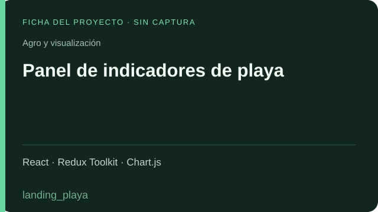 | **Panel de indicadores de playa** <code>landing_playa</code> · Aplicación Presenta litros, promociones y mezcla de ventas en distintas vistas, con gráficos, autenticación y configuración de la rotación de contenidos. React · Redux Toolkit · Chart.js · Ficha identificativa |
| 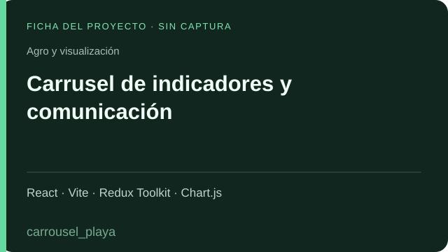 | **Carrusel de indicadores y comunicación** <code>carrousel_playa</code> · Versión relacionada Muestra un carrusel con indicadores de litros, lubricantes, mezcla de ventas, promociones y cliente incógnito, con configuración y control de conexión. React · Vite · Redux Toolkit · Chart.js · Ficha identificativa |
| 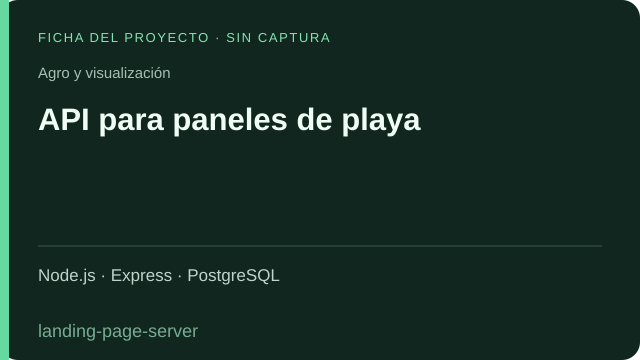 | **API para paneles de playa** <code>landing-page-server</code> · Backend Servicio de consultas para los paneles y carruseles: autenticación, información de Fusion e imágenes sobre una base PostgreSQL. Node.js · Express · PostgreSQL · Ficha identificativa |

## Web y contenido

| Proyecto | Repositorio y descripción |
| :--- | :--- |
| 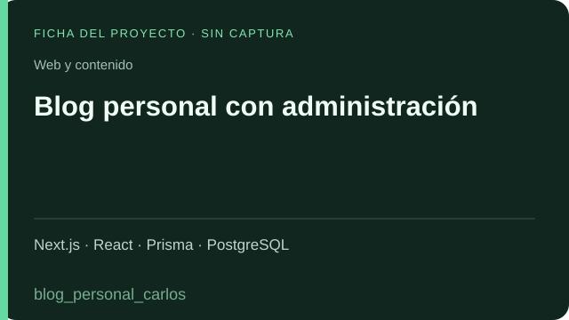 | **Blog personal con administración** <code>blog_personal_carlos</code> · Aplicación Blog con gestión de publicaciones, categorías, usuarios y perfil, panel privado, contenidos multimedia y seguimiento analítico. Next.js · React · Prisma · PostgreSQL · Ficha identificativa |
| 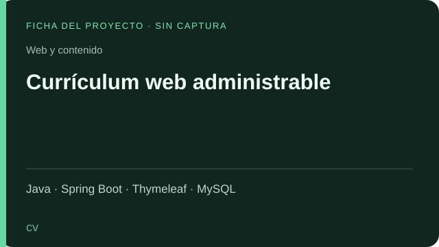 | **Currículum web administrable** <code>cv</code> · Proyecto Aplicación web para organizar datos personales, formación, cursos, experiencia laboral, habilidades e imágenes mediante módulos de gestión. Java · Spring Boot · Thymeleaf · MySQL · Ficha identificativa |

## Bases, aprendizaje e IA

| Proyecto | Repositorio y descripción |
| :--- | :--- |
| 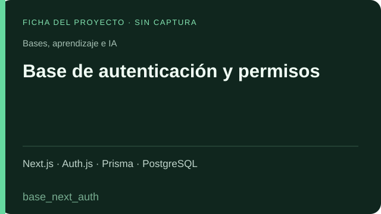 | **Base de autenticación y permisos** <code>base_next_auth</code> · Base reutilizable Punto de partida reutilizable con acceso por credenciales y proveedores externos, usuarios, roles, grupos y permisos para aplicaciones Next.js. Next.js · Auth.js · Prisma · PostgreSQL · Ficha identificativa |
| 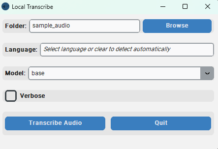 | **Transcripción local de audio y video** <code>whisper-local-transcribe-Editado</code> · Adaptación de terceros Adaptación de Local Transcribe with Whisper, de soderstromkr, con interfaz de escritorio, selección de idioma/modelo y procesamiento local con faster-whisper. Python · Tkinter · faster-whisper · Captura de la aplicación original adaptada |
|  | **Servidor de comunicación en tiempo real** <code>01-socket-server</code> · Práctica Base de servidor Express y Socket.IO para practicar conexiones y eventos entre clientes y servidor. Node.js · Express · Socket.IO · Ficha identificativa |
| 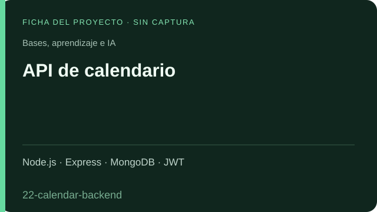 | **API de calendario** <code>22-calendar-backend</code> · Práctica Backend de práctica con registro e inicio de sesión, validación JWT y operaciones de creación, consulta, modificación y eliminación de eventos. Node.js · Express · MongoDB · JWT · Ficha identificativa |
|  | **Chat por salas con Django Channels** <code>asgiDjango</code> · Prototipo Prueba de comunicación asíncrona mediante WebSocket: conexión a salas, mensajes y distribución a los participantes del grupo. Python · Django Channels · WebSocket · Ficha identificativa |
| 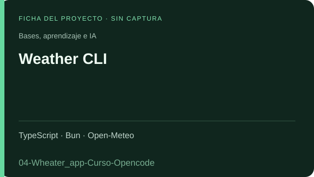 | **Weather CLI** <code>04-Wheater_app-Curso-Opencode</code> · Proyecto de aprendizaje Proyecto de aprendizaje con OpenCode: consulta clima y pronóstico de siete días por ciudad, guarda ubicaciones, configura unidades y temas y puede compilarse como ejecutable. TypeScript · Bun · Open-Meteo · Ficha identificativa |
| 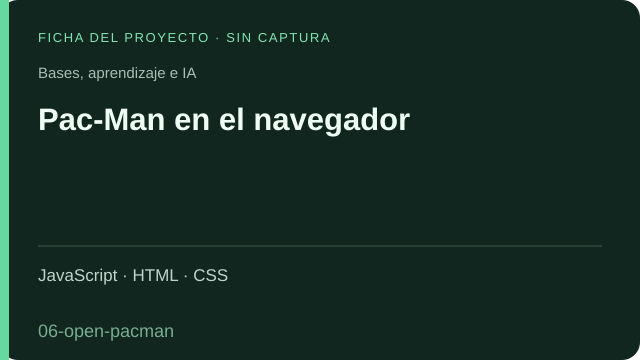 | **Pac-Man en el navegador** <code>06-open-pacman</code> · Proyecto de aprendizaje Juego con laberinto, puntuación, vidas, comportamientos de fantasmas y potenciadores; utilizado para practicar desarrollo guiado por especificaciones. JavaScript · HTML · CSS · Ficha identificativa |
|  | **Catálogo de biblioteca** <code>BibliotecaApp</code> · Proyecto de aprendizaje Aplicación de aprendizaje de Django con libros, autores, editores, portadas, búsquedas y vistas de mantenimiento. Python · Django · Ficha identificativa |
|  | **Prototipo de presupuesto** <code>DjangoApp</code> · Prototipo Proyecto inicial de presupuesto con categorías y subcategorías de ingresos y egresos. El módulo de movimientos revisado permanece sin implementar. Python · Django · Ficha identificativa |
| 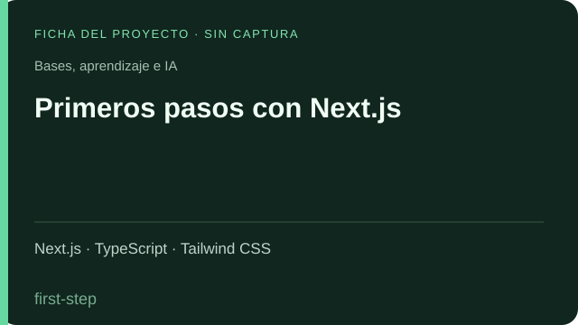 | **Primeros pasos con Next.js** <code>first-step</code> · Práctica Práctica de estructura de páginas, layouts, navegación y enlaces activos, con secciones de inicio, contacto, información y precios. Next.js · TypeScript · Tailwind CSS · Ficha identificativa |
| 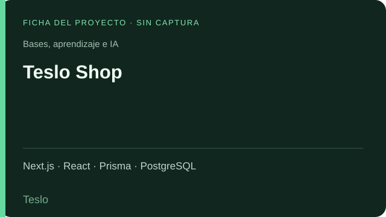 | **Teslo Shop** <code>Teslo</code> · Proyecto de aprendizaje Proyecto de práctica de tienda en línea con catálogo, categorías, carrito, direcciones, pedidos y autenticación sobre Next.js y Prisma. Next.js · React · Prisma · PostgreSQL · Ficha identificativa |
|  | **Base de escritorio con Electron y React** <code>Vite_electron</code> · Base de aprendizaje Proyecto de exploración de aplicaciones de escritorio con Electron, React y Vite, comunicación IPC y cambios de tema. Electron · React · Vite · Ficha identificativa |
| 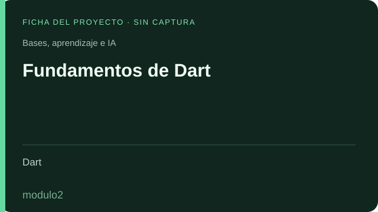 | **Fundamentos de Dart** <code>modulo2</code> · Ejercicios Colección de ejercicios sobre variables, condicionales, ciclos, funciones, listas, mapas, clases, herencia e interfaces. Dart · Ficha identificativa |
| 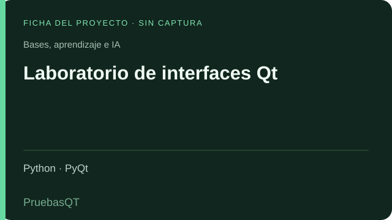 | **Laboratorio de interfaces Qt** <code>PruebasQT</code> · Laboratorio Colección de pruebas de controles, tablas, calendarios, ventanas, estilos, procesos asíncronos, generación de PDF y acceso a datos. Python · PyQt · Ficha identificativa |
| 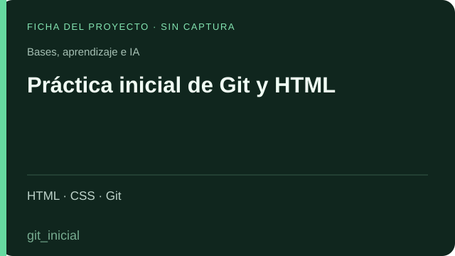 | **Práctica inicial de Git y HTML** <code>git_inicial</code> · Práctica Repositorio de iniciación con una página estática, estilos y recursos. Su documentación no define una aplicación de negocio. HTML · CSS · Git · Ficha identificativa |

## Pruebas de repositorio

| Proyecto | Repositorio y descripción |
| :--- | :--- |
|  | **Repositorio inicial de formación** <code>Egg</code> · Sin contenido visible El repositorio figura en la cuenta, pero su consulta de contenido devuelve una lista vacía. No hay una aplicación identificable para describir. Git · Ficha identificativa |
| 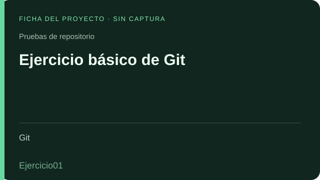 | **Ejercicio básico de Git** <code>Ejercicio01</code> · Ejercicio Contiene un archivo de texto con un ejercicio de edición y seguimiento de cambios; no corresponde a una aplicación. Git · Ficha identificativa |
|  | **Prueba de página y cambios en Git** <code>GitImpulsa</code> · Prueba Repositorio personal con una página HTML de prueba; se incluye por pertenecer a Danito90, sin incorporar repositorios de organizaciones. HTML · Git · Ficha identificativa |
|  | **Práctica grupal de GitHub** <code>practica_github</code> · Ejercicio Repositorio con documentación de práctica grupal; no contiene una aplicación ejecutable identificable. Git · GitHub · Ficha identificativa |

## Proyectos personales públicos · Simracing

Iniciativas personales vinculadas al simracing, independientes de mi trabajo profesional. Ambos repositorios tienen código público.

| Proyecto | Repositorio y descripción |
| :--- | :--- |
|  | **Apex Telemetry y plataforma de simracing** <a href="https://github.com/Danito90/Telemetria"><code>Telemetria</code></a> · Proyecto personal · Código público Captura telemetría de F1 por UDP y de Assetto Corsa por memoria compartida; almacena sesiones y vueltas, muestra datos por WebSocket y permite comparar y exportar. Incluye un subproyecto web de gestión de torneos. Python · SQLite · WebSocket · Next.js · Ficha identificativa |
|  | **Gestión de ligas de F1** <a href="https://github.com/Danito90/f1-league-app"><code>f1-league-app</code></a> · Proyecto personal · Código público Plataforma para administrar ligas, temporadas, pilotos, constructores, carreras, resultados y puntuaciones, con tablas de posiciones. Next.js · TypeScript · Prisma · Ficha identificativa |

## Relaciones que ayudan a leer el catálogo

- **Gestión agrícola:** `Api_finca` aporta el backend y `Finca_react` la interfaz; se describen como componentes de una misma línea funcional.
- **Indicadores y formularios:** `Formularios_carga` y `formularios-frontend` forman una línea backend/frontend; `Formularios_Django` es otra implementación relacionada.
- **Paneles de playa:** `landing_playa` y `carrousel_playa` son interfaces relacionadas; `landing-page-server` aporta consultas y servicios.
- **Medición de tanques:** las versiones por estación comparten el propósito; `Medicion_unico` concentra esa línea en una aplicación configurable.
- **Incidencias:** `PWA_incidencia` y `gestion_incidencia` pertenecen a la misma familia funcional. No se afirma una cronología de reemplazo sin comprobarla.
- **Integración con Fusion:** `Auto_axion`, `Fusion_dll` y `UpFusionUnico` implementan enfoques de descarga e integración; no se presupone que los tres sigan operativos.
- **Proyectos personales de simracing:** `Telemetria` contiene el capturador local y el subproyecto `TorneosSimRacing`; `f1-league-app` es otro repositorio de gestión de ligas.
- **Transcripción:** `whisper-local-transcribe-Editado` es una adaptación de [soderstromkr/whisper-local-transcribe](https://github.com/soderstromkr/whisper-local-transcribe), no una implementación del modelo Whisper desde cero.
